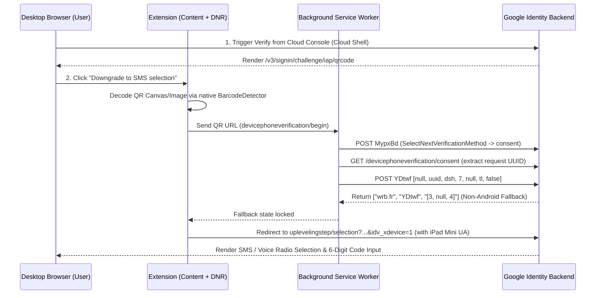

# Google QR SMS Helper (`google-qr-sms-helper`)

<p align="center">
  
  
  
  
</p>

<p align="center">
  <b>Force Google's mandatory cross-device QR verification (MO-SMS / GMS Constellation) back to the classic "enter a phone number and receive a 6-digit SMS code" flow on desktop browsers.</b><br/>
  Switch Google's mandatory cross-device QR verification back to standard 6-digit SMS / Voice verification on desktop browsers.
</p>

---

## 📦 1. Installation

### Option 1: Download the release archive (recommended for beginners)
1. Go to the repository's **[Releases page](https://github.com/havenicec/google-qr-sms-helper/releases/latest)**, download the latest `google-qr-sms-helper-v1.1.0.zip` and extract it into a local folder.
2. Open Chrome / Edge / Brave and enter `chrome://extensions/` in the address bar.
3. Turn on **Developer mode** in the top-right corner of the page.
4. Click **Load unpacked** in the top-left and select the extracted folder.

### Option 2: Install via Git
```bash
git clone https://github.com/havenicec/google-qr-sms-helper.git
```
Then open `chrome://extensions/`, enable Developer mode, click **Load unpacked** and select the `google-qr-sms-helper` directory.

---

## 🚀 2. Step-by-Step Usage Guide

> [!IMPORTANT]
> **Key prerequisite (must read):** **Do not** downgrade from a QR page opened from a third-party client (such as an Antigravity / Gemini Code Assist authorization page), because its `continue` parameter contains multiple layers of nested redirects and Google will bounce you back to the QR code.
> **You must first open Google Cloud Console and trigger the native `Verify` window through Cloud Shell!** Once you complete SMS verification here, your Google account is unlocked globally; signing in to Antigravity and similar tools afterwards will work smoothly.

### Step 1: Open Google Cloud Console and trigger Cloud Shell verification
1. Sign in to the Google account you want to verify and visit **[https://console.cloud.google.com/](https://console.cloud.google.com/)**.
2. As shown below, click the **Activate Cloud Shell** terminal icon `[>_]` in the top-right navigation bar (or click the floating panel button at the bottom right: `1. Auto-click Cloud Shell icon`).
3. In the `Verify your account` window that appears at the bottom, click the blue **Verify** button:


### Step 2: On the QR page, click "Downgrade to SMS selection"
1. After clicking `Verify`, Google's QR verification page appears (`/v3/signin/challenge/iap/qrcode`).
2. Once the QR image has fully loaded, click the extension panel's **"⚡ Downgrade to SMS selection"** button:
   - The extension decodes the QR canvas/image with the browser's native `BarcodeDetector`;
   - It sends the `MypxBd` and `YDtwf ([null, uuid, dsh, 7, null, tl, false])` requests to Google in the background and receives `[3, null, 4]` (the non-Android fallback-to-SMS state);
   - It spoofs the current tab's request headers and environment as an **iPad Mini** (no manual F12 device switching needed) and redirects to `uplevelingstep/selection?...&idv_xdevice=1`.

### Step 3: Choose "Text message" and enter your phone number to receive the code
1. The page automatically redirects to the verification method selection page (`/uplevelingstep/selection`):
   - Select **Text message (SMS)** (or voice call) and click Next.
2. Enter the phone number that will receive the code (numbers from any country's SMS-receiving service or a physical SIM all work) and request the code.
3. Enter the 6-digit `G-xxxxxx` code you receive and click **Next**. Verification is complete!
4. After verification, refresh Cloud Shell or Antigravity / Gemini CLI and keep working.

---

## ❓ 3. FAQ & Troubleshooting

### Q1: Why does clicking "Downgrade" on a QR page opened from another link bounce back to the QR code?
- **Reason:** Only the QR page triggered by **Cloud Shell `[>_]` → `Verify`** from `https://console.cloud.google.com/` has a clean `continue` parameter: `https://accounts.google.com/uplevelingstep/selection?TL=...&authuser=0&flowName=GlifWebSignIn&sarp=1&scc=1`. Make sure you enter through the Cloud Shell flow described in Step 1.

### Q2: Why spoof an `iPad Mini` instead of an `iPad Pro` or a desktop browser?
- **Reason:** Google's `uplevelingstep/selection` endpoint validates the `User-Agent`:
  - Desktop (Windows / macOS) and Chrome's F12 `iPad Pro 13` preset both send a desktop-grade `Macintosh; Intel Mac OS X` UA. Google detects a desktop environment and ignores `idv_xdevice=1`, forcing you back to the QR code.
  - `iPad Mini` sends a pure mobile `iPad; CPU OS 16_6 like Mac OS X ... Mobile/15E148` header, and the `/_/IdvUplevelingUi/data/batchexecute` endpoint that submits the 6-digit code must keep exactly the same `iPad Mini` headers end to end (v1.1.0 does this automatically via `declarativeNetRequest`; no manual F12 needed).

### Q3: What if "Could not detect a QR code on this page" appears?
- Make sure you are using **Chrome / Edge 88+** (native `BarcodeDetector` support) and wait until the black QR pattern has fully rendered before clicking the button.

---

## ✨ 4. Architecture & Workflow



---

## 📁 Project Structure

```text
google-qr-sms-helper/
├── assets/
│   └── cloud-shell-verify.png  # Cloud Shell Verify entry point screenshot
├── manifest.json               # Chrome Extension Manifest V3 configuration
├── background.js               # DNR-wide iPad Mini header spoofing + [3,null,4] RPC injection
├── content.js                  # Floating panel + BarcodeDetector QR decoding + URL cleanup/redirect
├── ua_spoof.js                 # Main-world navigator property alignment
├── LICENSE                     # MIT license
└── README.md                   # Project documentation and visual guide
```

---

## 📄 License

Released under the [MIT License](./LICENSE).
